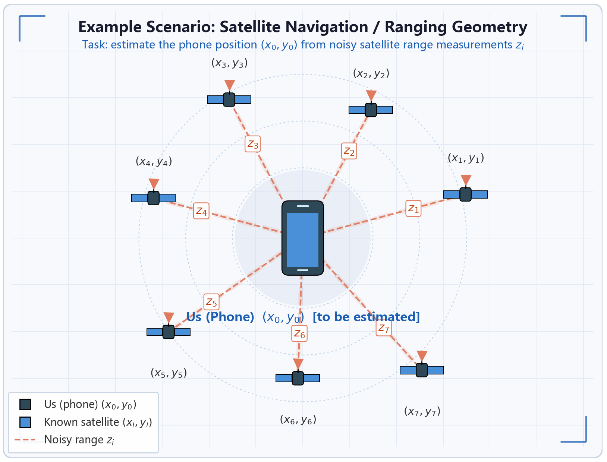

# Project 1

## Satellite Range Distance Space Localisation & Parameter Estimation

### Example scenario: Satellite navigation / ranging geometry

**Task:** Estimate the phone position $(x_0, y_0)$ from noisy satellite range measurements $z_i$.

### System & measurement models

The unknown parameter is $\boldsymbol{\theta} = (x_0, y_0)$, the phone position to be estimated. The satellite positions $(x_i, y_i)$ are known.

$$
z_i = \sqrt{(x_i - x_0)^2 + (y_i - y_0)^2} + v_i,
\qquad v_i \sim \mathcal{N}(0, R),
\qquad i = 1, \ldots, N.
$$

Estimating the phone position from the noisy ranges $\{z_i\}$ is a parameter estimation problem.

## Requirements

**Note:** The figure above is only an **example project**. The phone position $(x_0, y_0)$ is unknown, while the satellite positions $(x_i, y_i)$ are known. The core task in this example is to estimate the phone position from noisy ranges $z_i$.

### I. Detailed requirements

1. **Short paper:** Choose **any** modelling/project topic related to parameter estimation or estimation filtering, and complete the formulation and design. The figure above is only an example, not a required topic.
2. **Algorithm design:** For the example parameter estimation project, estimate the phone position using least squares (LS), weighted least squares (WLS), maximum likelihood (ML), Bayesian estimation, etc.
3. **Literature:** Search for and cite related papers on IEEE Xplore. Recommended keywords: state estimation, filtering, range measurement, sensor network, target localisation.
4. **Paper structure:** Include the problem description, measurement model, estimation derivation (e.g., linearisation of the nonlinear measurement or a weighted iterative solution), simulation experiments, and result analysis.

### II. Bonus: extra +5 points

The bonus applies to **any chosen project**. **Achieving any one of the following items earns the bonus.**

1. Derive the CRLB (Cramér–Rao Lower Bound) in the simulation section.
2. Compute the Fisher information matrix (FIM) and invert it to obtain the theoretical variance lower bound.
3. Plot the estimator's simulation RMSE curve against the CRLB bound on the same figure and analyse it, demonstrating that the estimator achieves theoretical optimality.
