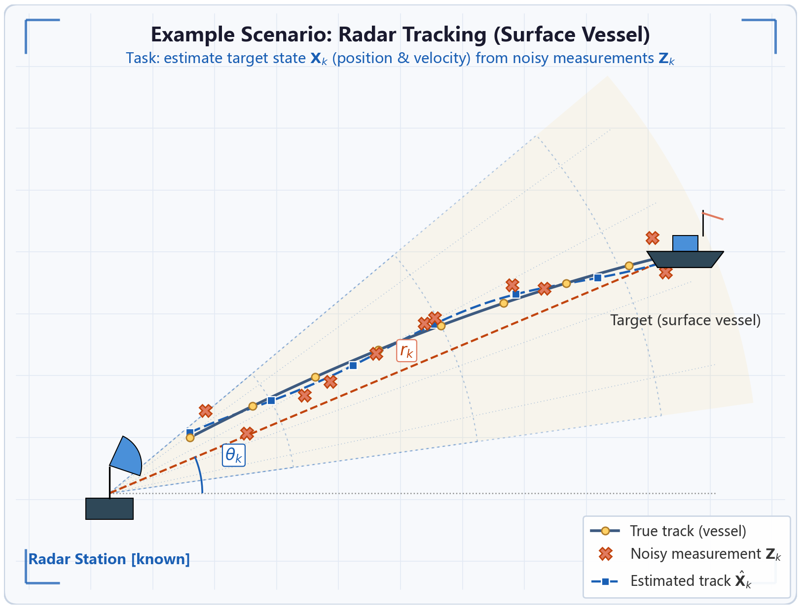

# Project 2

## Radar Target Tracking: Kalman Filter & Its Improvements

### Example scenario: Radar tracking (surface vessel)

**Task:** Estimate the target state $\mathbf{X}_k$ (position and velocity) from noisy measurements $\mathbf{Z}_k$.

### State & measurement models (Kalman filter baseline)

The state contains position and velocity:

$$
\mathbf{X}_k =
\begin{bmatrix}
x_k & \dot{x}_k & y_k & \dot{y}_k
\end{bmatrix}^{\mathsf{T}}.
$$

The state transition model is:

$$
\mathbf{X}_{k+1} = F\mathbf{X}_k + \mathbf{W}_k,
\qquad \mathbf{W}_k \sim \mathcal{N}(0, Q).
$$

The linear measurement model is:

$$
\mathbf{Z}_k =
\begin{bmatrix}
1 & 0 & 0 & 0 \\
0 & 0 & 1 & 0
\end{bmatrix}
\mathbf{X}_k + \mathbf{V}_k,
\qquad \mathbf{V}_k \sim \mathcal{N}(0, R).
$$

The radar polar measurement model is:

$$
z_k^r = \sqrt{x_k^2 + y_k^2} + v_k^r,
\qquad
z_k^{\theta} = \arctan\!\left(\frac{y_k}{x_k}\right) + v_k^{\theta}.
$$

The polar measurement model is nonlinear and calls for an extended Kalman filter (EKF) or unscented Kalman filter (UKF).

## Requirements

**Note:** The figure above is the **baseline scenario**: a radar tracks a surface vessel in 2D. The state and measurement models are shown above; the baseline estimator is the linear Kalman filter (KF).

### I. Improvement directions

**Choose one of the following three directions, or do all three.**

1. **3D modelling:** Extend the model to 3D tracking (e.g., UAV radar tracking) by adding the states $z_k$ and $\dot{z}_k$.
2. **Nonlinear measurement:** Use radar outputs in polar coordinates $(r_k, \theta_k)$, as shown above, and switch to nonlinear filters such as EKF or UKF.
3. **Noise improvement:** Replace white noise with coloured or other noise (e.g., autoregressive (AR) noise or random walk). Re-model the problem and re-derive the filter.

### II. Paper requirements (same as Project 1)

1. Write a short paper including the problem description, system/measurement models, filtering derivation, simulation experiments, and result analysis.
2. Algorithms must be filtering-related. Search for and cite papers on IEEE Xplore.
3. Include comparison curves (e.g., RMSE) for the baseline KF versus the improved method.
