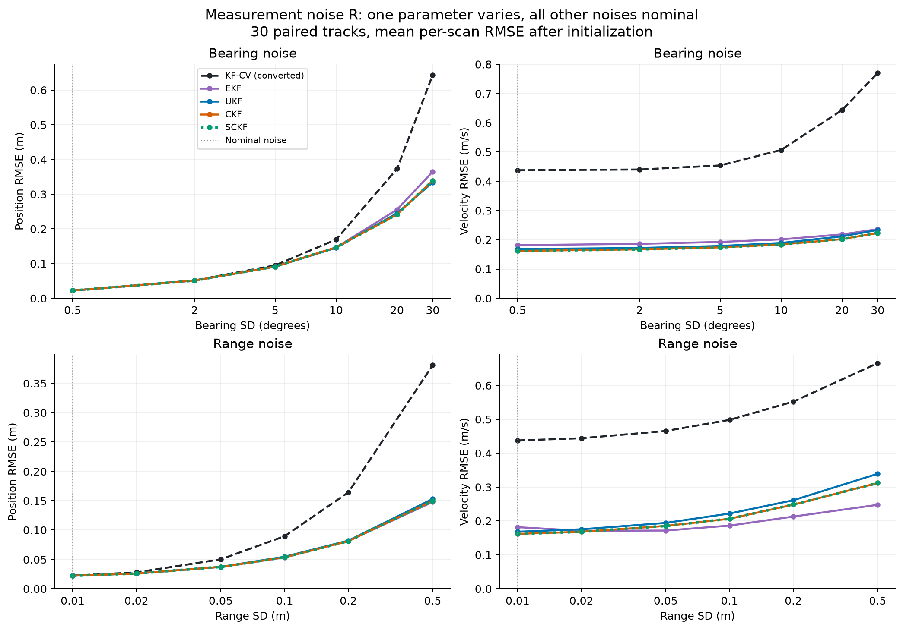
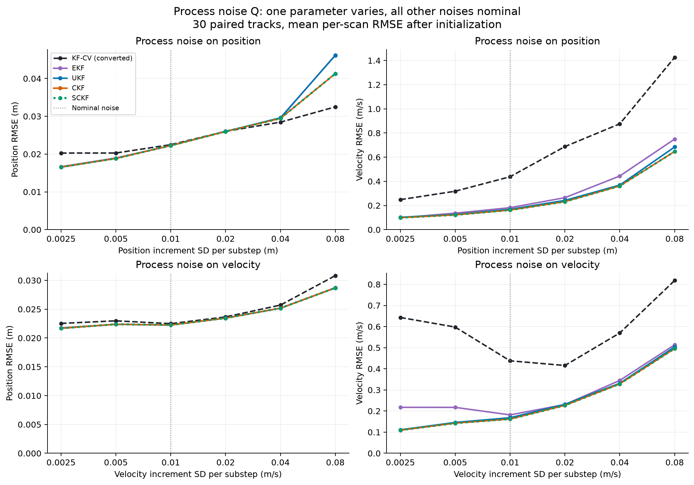

# State estimation: KF comparison and noise sensitivity

## What the assignment asks

[Project 2](../Project%202.md) includes both process noise $\mathbf{W}_k\sim\mathcal{N}(0,Q)$ and measurement noise $\mathbf{V}_k\sim\mathcal{N}(0,R)$. It gives no numerical values for their covariances and does not require a noise sensitivity sweep. Replacing white noise with coloured noise, AR noise or a random walk is an optional improvement direction. The project already follows the nonlinear radar measurement direction.

The experiments below model **both process and measurement noise** as independent, temporally white Gaussian sequences. Varying their standard deviations studies noise intensity; it does not implement the optional coloured-noise extension.

## Models and parameters

The code's state is $\mathbf{x}=[p_x,p_y,v_x,v_y]^T$. The simulated ship and all nonlinear filters use the existing nonlinear shore-turn model. A velocity correction acts outside a radius of 5 m when the vessel moves away from the origin. The linear KF baseline uses constant velocity, without this turning correction.

Per integration substep, the additive process-noise covariance is

$$
Q=\operatorname{diag}(q_p^2,q_p^2,q_v^2,q_v^2).
$$

Here $q_p$ is the standard deviation of each position increment, in metres per substep, and $q_v$ is that of each velocity increment, in m/s per substep. These are discrete increment standard deviations, not continuous-time spectral densities. Increments are mutually independent and independent across time.

The radar at the origin measures

$$
r_m=\sqrt{p_x^2+p_y^2}+v_r,
\qquad \theta_m=\operatorname{atan2}(p_y,p_x)+v_\theta.
$$

Its independent range and bearing errors have covariance

$$
R=\operatorname{diag}(\sigma_r^2,\sigma_\theta^2).
$$

Bearing standard deviations are displayed in degrees, converted to radians before computing $R$. Position and velocity process noises belong to $Q$; range and bearing noises belong to $R$.

| Parameter | Nominal SD | Sweep values |
| --- | --- | --- |
| Bearing measurement $\sigma_\theta$ | 0.5 degrees | 0.5, 2, 5, 10, 20, 30 degrees |
| Range measurement $\sigma_r$ | 0.01 m | 0.01, 0.02, 0.05, 0.1, 0.2, 0.5 m |
| Position process increment $q_p$ | 0.01 m | 0.0025, 0.005, 0.01, 0.02, 0.04, 0.08 m |
| Velocity process increment $q_v$ | 0.01 m/s | 0.0025, 0.005, 0.01, 0.02, 0.04, 0.08 m/s |

**One parameter varies at a time.** Within a process-noise sweep, the same SD is used for the two symmetric spatial axes, while the other process-noise block and both measurement noises stay nominal. Standard deviations are varied, so multiplying an SD by two multiplies its variance by four.

## Linear KF baseline

For the state ordering used here, the fixed linear state and observation matrices are

$$
F=\begin{bmatrix}1&0&\Delta t&0\\0&1&0&\Delta t\\0&0&1&0\\0&0&0&1\end{bmatrix},
\qquad H=\begin{bmatrix}1&0&0&0\\0&1&0&0\end{bmatrix}.
$$

The baseline aggregates five linear predictions and their process covariance exactly into one radar-scan prediction. It receives the same radar observations as the nonlinear filters, converted to Cartesian position. For example, a 5 m range at 0 degrees corresponds to $(5,0)$ m. Angular uncertainty makes converted errors anisotropic and non-Gaussian.

Let $a=\sigma_\theta^2$. The raw Cartesian conversion shrinks the expected position by $e^{-a/2}$. The baseline removes that bias using

$$
\mathbf{z}_c=e^{a/2}r_m\begin{bmatrix}\cos\theta_m\\\sin\theta_m\end{bmatrix}.
$$

At a fixed true range $\rho$, the radial and tangential error variances of this conversion are

$$
d_r=(\rho^2+\sigma_r^2)\cosh(a)-\rho^2,
\qquad d_t=(\rho^2+\sigma_r^2)\sinh(a).
$$

Rotate $\operatorname{diag}(d_r,d_t)$ by the target bearing to obtain the Cartesian covariance. Since truth is unavailable, the KF substitutes its predicted position. Its matrices $F,H$ are fixed, but its measurement covariance varies with the prediction. This plug-in approximation is not an exact Gaussian/MMSE solution or a full implementation of a published consistent converted-measurement filter.

Converted-measurement filtering and its conversion bias and covariance issues are discussed by [Pei (2025)](https://www.jhuapl.edu/sites/default/files/2025-09/38-01-Pei.pdf) and [Spitzmiller and Adhami (2010)](https://file.scirp.org/pdf/iim20100400006_66126447.pdf).

## Experimental protocol

- 30 trajectories per condition, 800 radar scans per trajectory, seed 20261026.
- Integration step 0.01 s, 5 substeps per radar scan, radar interval 0.05 s, trajectory duration 40 s.
- The same initial states and standardized process and measurement draws are reused across every condition. Changing measurement noise leaves truth unchanged. Changing process noise necessarily changes the trajectories, using the same underlying random draws.
- Within each condition, all five filters receive identical truth and observations for evaluation. Each filter is given the actual noise levels: both its $Q$ and $R$ are updated to match the simulator. This is a matched-noise sensitivity study, not a covariance-misspecification experiment.
- Every filter starts from mean $[1,1,1,1]^T$ and covariance $10I_4$. The nonlinear shore-turn model and all other parameters remain fixed. KF-CV retains its constant-velocity model and has no separate maneuver-noise tuning.
- Position RMSE at each scan is the square root of the mean squared Euclidean position error across all trajectories. Velocity RMSE uses the two velocity components. Tables average these per-scan RMSE values over scans 301-800 (15.05-40 s). They do not pool time samples before taking the square root.
- All tracks enter the metrics. A non-finite estimate or numerical failure invalidates the entire method/condition; survivor-only averages are not reported. Failed points appear as gaps in graphs and `FAILED` in tables.
- The nominal condition is identical in all four sweeps and is evaluated once, then reused within this execution. There are 24 displayed points and 21 unique configurations. CKF and SCKF are both executed, even where their curves overlap.
- The EKF evaluates the dynamics Jacobian before propagation. Timings include filtering and conversion, excluding simulation and plotting; they depend on implementation and hardware.

## Nominal-noise comparison

All four noise standard deviations are nominal. Runtime is per 800-scan track.

| Method | Position RMSE (m) | Velocity RMSE (m/s) | Runtime (ms/track) | Tracks |
| --- | ---: | ---: | ---: | ---: |
| KF-CV (converted) | 0.0225 | 0.4378 | 19.0 | 30/30 |
| EKF | 0.0222 | 0.1818 | 66.3 | 30/30 |
| UKF | 0.0223 | 0.1684 | 151.9 | 30/30 |
| CKF | 0.0223 | 0.1620 | 149.2 | 30/30 |
| SCKF | 0.0223 | 0.1620 | 176.4 | 30/30 |

## Measurement noise

Each table cell is **position RMSE (m) / velocity RMSE (m/s)**. All other noise parameters stay at the nominal values above.



### Bearing noise

| Bearing SD (degrees) | KF-CV (converted) | EKF | UKF | CKF | SCKF |
| ---: | ---: | ---: | ---: | ---: | ---: |
| 0.5 | 0.0225 / 0.4378 | 0.0222 / 0.1818 | 0.0223 / 0.1684 | 0.0223 / 0.1620 | 0.0223 / 0.1620 |
| 2 | 0.0516 / 0.4403 | 0.0511 / 0.1861 | 0.0511 / 0.1721 | 0.0512 / 0.1673 | 0.0512 / 0.1673 |
| 5 | 0.0950 / 0.4541 | 0.0911 / 0.1927 | 0.0912 / 0.1788 | 0.0914 / 0.1741 | 0.0914 / 0.1741 |
| 10 | 0.1693 / 0.5070 | 0.1464 / 0.2015 | 0.1454 / 0.1892 | 0.1468 / 0.1839 | 0.1468 / 0.1839 |
| 20 | 0.3730 / 0.6435 | 0.2557 / 0.2185 | 0.2451 / 0.2118 | 0.2415 / 0.2023 | 0.2415 / 0.2023 |
| 30 | 0.6435 / 0.7701 | 0.3647 / 0.2362 | 0.3339 / 0.2336 | 0.3390 / 0.2231 | 0.3390 / 0.2231 |

### Range noise

| Range SD (m) | KF-CV (converted) | EKF | UKF | CKF | SCKF |
| ---: | ---: | ---: | ---: | ---: | ---: |
| 0.01 | 0.0225 / 0.4378 | 0.0222 / 0.1818 | 0.0223 / 0.1684 | 0.0223 / 0.1620 | 0.0223 / 0.1620 |
| 0.02 | 0.0280 / 0.4442 | 0.0260 / 0.1713 | 0.0260 / 0.1755 | 0.0260 / 0.1681 | 0.0260 / 0.1681 |
| 0.05 | 0.0502 / 0.4657 | 0.0372 / 0.1718 | 0.0374 / 0.1944 | 0.0374 / 0.1854 | 0.0374 / 0.1854 |
| 0.1 | 0.0896 / 0.4984 | 0.0534 / 0.1864 | 0.0546 / 0.2221 | 0.0537 / 0.2067 | 0.0537 / 0.2067 |
| 0.2 | 0.1643 / 0.5522 | 0.0815 / 0.2131 | 0.0821 / 0.2613 | 0.0812 / 0.2483 | 0.0812 / 0.2483 |
| 0.5 | 0.3810 / 0.6658 | 0.1479 / 0.2478 | 0.1530 / 0.3393 | 0.1498 / 0.3121 | 0.1498 / 0.3121 |


## Process noise

Each table cell is **position RMSE (m) / velocity RMSE (m/s)**. All other noise parameters stay at the nominal values above.



### Process noise on position

| Position increment SD per substep (m) | KF-CV (converted) | EKF | UKF | CKF | SCKF |
| ---: | ---: | ---: | ---: | ---: | ---: |
| 0.0025 | 0.0203 / 0.2483 | 0.0167 / 0.0986 | 0.0165 / 0.1026 | 0.0166 / 0.0990 | 0.0166 / 0.0990 |
| 0.005 | 0.0203 / 0.3181 | 0.0190 / 0.1364 | 0.0189 / 0.1253 | 0.0189 / 0.1222 | 0.0189 / 0.1222 |
| 0.01 | 0.0225 / 0.4378 | 0.0222 / 0.1818 | 0.0223 / 0.1684 | 0.0223 / 0.1620 | 0.0223 / 0.1620 |
| 0.02 | 0.0260 / 0.6875 | 0.0260 / 0.2647 | 0.0260 / 0.2421 | 0.0260 / 0.2320 | 0.0260 / 0.2320 |
| 0.04 | 0.0285 / 0.8759 | 0.0295 / 0.4442 | 0.0296 / 0.3688 | 0.0295 / 0.3618 | 0.0295 / 0.3618 |
| 0.08 | 0.0325 / 1.4258 | 0.0462 / 0.7499 | 0.0461 / 0.6845 | 0.0413 / 0.6472 | 0.0413 / 0.6472 |

### Process noise on velocity

| Velocity increment SD per substep (m/s) | KF-CV (converted) | EKF | UKF | CKF | SCKF |
| ---: | ---: | ---: | ---: | ---: | ---: |
| 0.0025 | 0.0225 / 0.6431 | 0.0218 / 0.2177 | 0.0217 / 0.1113 | 0.0217 / 0.1092 | 0.0217 / 0.1092 |
| 0.005 | 0.0230 / 0.5975 | 0.0224 / 0.2174 | 0.0224 / 0.1461 | 0.0224 / 0.1426 | 0.0224 / 0.1426 |
| 0.01 | 0.0225 / 0.4378 | 0.0222 / 0.1818 | 0.0223 / 0.1684 | 0.0223 / 0.1620 | 0.0223 / 0.1620 |
| 0.02 | 0.0237 / 0.4157 | 0.0234 / 0.2308 | 0.0235 / 0.2317 | 0.0235 / 0.2268 | 0.0235 / 0.2268 |
| 0.04 | 0.0257 / 0.5697 | 0.0252 / 0.3450 | 0.0252 / 0.3316 | 0.0252 / 0.3287 | 0.0252 / 0.3287 |
| 0.08 | 0.0308 / 0.8182 | 0.0287 / 0.5137 | 0.0287 / 0.5036 | 0.0287 / 0.4959 | 0.0287 / 0.4959 |

## Interpretation and limits

All five filters produced finite estimates for all 30 tracks in every condition.

At the highest tested bearing noise (30), KF-CV vs CKF position RMSE is 0.6435 vs 0.3390 m, and velocity RMSE is 0.7701 vs 0.2231 m/s.

At the highest tested range noise (0.5), KF-CV vs CKF position RMSE is 0.3810 vs 0.1498 m, and velocity RMSE is 0.6658 vs 0.3121 m/s.

At the highest tested process noise on position (0.08), KF-CV vs CKF position RMSE is 0.0325 vs 0.0413 m, and velocity RMSE is 1.4258 vs 0.6472 m/s.

At the highest tested process noise on velocity (0.08), KF-CV vs CKF position RMSE is 0.0308 vs 0.0287 m, and velocity RMSE is 0.8182 vs 0.4959 m/s.

The comparison includes motion-model mismatch: nonlinear filters know the ship's turning force, whereas KF-CV does not. Differences must not be attributed solely to measurement nonlinearity. In particular, higher process noise changes the physical trajectories and when turns occur; the process sweep is not merely a change in filter confidence. No monotonic ranking or universal superiority follows from this finite ensemble. A separate constant-velocity truth experiment could isolate measurement effects, and a separate mismatched-noise experiment could test incorrect assumed $Q/R$.

Gaussian range errors are not clipped: the observation model can produce negative noisy ranges near the origin. This retains the stated additive Gaussian model. No samples are removed on that basis.

## Project files and reproduction

The project keeps a single current results file, [noise-sensitivity.json](noise-sensitivity.json), containing settings, source hashes, per-condition summaries, and full per-scan RMSE curves. The simulation entry point is `noise_sensitivity.py`; the filter and ship model implementations are in `ship_benchmark.py`. PNG and SVG versions of the two figures are in `figures/`.

From this folder, with NumPy and Matplotlib installed:

```bash
python3 -m unittest -v test_kf_baseline.py test_noise_sensitivity.py
python3 noise_sensitivity.py --runs 30 --scans 800 --out noise-sensitivity.json
python3 make_kf_report.py
```

Tests cover conversion statistics against Monte Carlo samples, the linear KF, process covariance aggregation, the EKF Jacobian evaluation point, changing exactly one noise parameter, matching simulator/filter covariances, restoring parameters after exceptions, replaying the original random draw order, preserving truth for measurement sweeps, and reusing standardized measurement noise for process sweeps.

The original exported `../presentation.html` remains a source presentation; it does not include these new figures. A short paper with the required literature citations remains to be prepared.

Execution environment: Darwin arm64, Python 3.14.4, NumPy 2.5.1.
